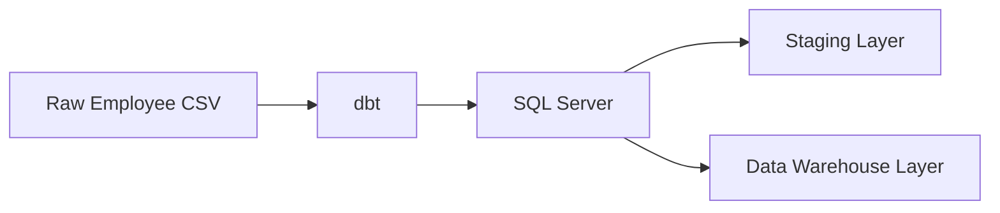

# Employee Data Warehouse | dbt & SQL Server

## Project Overview

This project builds an employee data warehouse using dbt and SQL Server.

It starts with raw employee data and transforms it into structured datasets through staging and data warehouse models.

## Architecture



## Tech Stack

- **dbt Core** – Data transformation and modeling.
- **SQL Server** – Database and data warehouse.
- **SQL** – Data querying and transformation.
- **Python** – Project environment and tooling.
- **YAML** – dbt configuration and data tests.
- **Git & GitHub** – Version control.

## Project Structure

```text
depi_dbt/
│
├── models/
│   ├── staging/
│   │   ├── DIMCountry.sql
│   │   ├── DIMDate.sql
│   │   ├── DIMDepartment.sql
│   │   ├── DIMEmployee.sql
│   │   ├── DIMGender.sql
│   │   ├── OBT.sql
│   │   └── schema.yml
│   │
│   └── DWH/
│       ├── dim_country.sql
│       ├── dim_date.sql
│       ├── dim_depatment.sql
│       ├── dim_employee.sql
│       ├── dim_gender.sql
│       └── factTable.sql
│
├── seeds/
│   └── DEPI_data.csv
│
├── macros/
│   ├── capitalize_name.sql
│   ├── generate_schema_name.sql
│   └── salary_category.sql
│
├── tests/
│   ├── dob_not_future.sql
│   └── negative_salary.sql
│
├── dbt_project.yml
├── .gitignore
└── README.md
```

## Data Quality

The project includes:

- `not_null` and `unique` tests.
- Accepted values validation for gender.
- Custom tests to detect future dates of birth and negative salaries.

## Macros

Reusable macros for:
- Capitalizing employee names.
- Generating schema names.
- Categorizing employee salaries.

## Getting Started

Clone the repository:

```bash
git clone https://github.com/johnnaoum-creator/dbt-data-warehouse-project.git
```

Install the required packages:

```bash
pip install dbt-core dbt-sqlserver
```

Configure your SQL Server connection in `profiles.yml`, then run:

```bash
dbt seed
dbt build
```

Generate and view dbt documentation:

```bash
dbt docs generate
dbt docs serve
```

## Author

**John Naoum**

- GitHub: https://github.com/johnnaoum-creator
- Project Repository: https://github.com/johnnaoum-creator/dbt-data-warehouse-project
